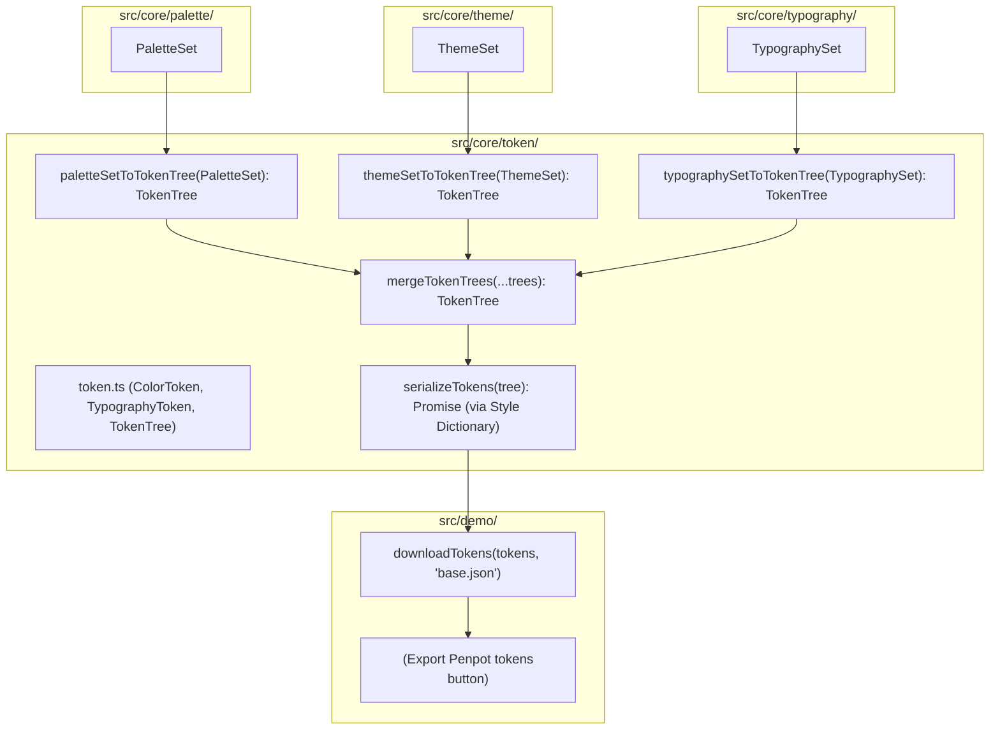

# Anima 0.5: Style Dictionary Token Implementation & Serialization

## 1. Overview & Problem Statement

### 1.1 Context & Background

Anima 0.1 through 0.4 established perceptual color palette generation using radial chroma boundary sampling in OKLCH color space, an 8-theme architecture (Light 0–3 and Dark 0–3), typography design tokens, and a manual token export mechanism originally targeted at Penpot.

Currently:

- The token data models, tree generation, and merging logic are housed in `src/core/penpot/` with vendor-specific naming (`PenpotColorToken`, `PenpotTypographyToken`, `PenpotTokenTree`, `paletteSetToPenpotTokenTree`, `themeSetToPenpotTokenTree`, `typographySetToPenpotTokenTree`, `mergePenpotTokenTrees`).
- Token serialization in `src/demo/download-penpot-tokens.ts` uses naive `JSON.stringify(tokenTree, null, 2)` without leveraging standard token tooling.
- Although the token data structure loosely follows the W3C Design Tokens Community Group (DTCG) specification (`$value`, `$type`), it is coupled to Penpot terminology and lacks integration with the standard token build toolchain: **Style Dictionary**.

### 1.2 Problem Statement

1. **Vendor Coupling**: Core token representations and functions are named after `penpot`, despite the fact that DTCG tokens are vendor-agnostic and consume standard W3C token definitions.
2. **Missing Standard Tooling**: Token serialization is handled via ad-hoc JSON stringification rather than using an industry-standard token engine like Style Dictionary to validate and serialize token trees.
3. **Public API Inconsistency**: Consumers importing from `anima` (`src/index.ts`) must consume Penpot-prefixed functions rather than canonical domain token APIs.

### 1.3 Design Goals & Invariants

- **Zero UI / Behavioral Regressions**: Preserve existing demo UI labels ("Export Penpot tokens") and downloaded artifact filename (`base.json`), ensuring seamless backwards compatibility for designers and workflows.
- **Canonical Module Reorganization (`src/core/token/`)**:
  - Replace `src/core/penpot/` with `src/core/token/`.
  - Generalize token interfaces: `ColorToken`, `TypographyToken`, `TokenTree` conforming strictly to the W3C DTCG / Style Dictionary specification (`$value`, `$type`, `$description`).
  - Rename converters to canonical names: `paletteSetToTokenTree`, `themeSetToTokenTree`, `typographySetToTokenTree`, `mergeTokenTrees`.
- **Style Dictionary Token Serialization (`src/core/token/serialize-tokens.ts`)**:
  - Integrate `style-dictionary` v4 as the token serialization engine.
  - Implement `serializeTokens(tokens: TokenTree): Promise<string>` that passes the token tree into Style Dictionary in-memory and outputs formatted, valid DTCG JSON preserving `$value`, `$type`, and `{aliases}`.
- **Public API Clean Break**:
  - Update `src/index.ts` to export all canonical token utilities from `./core/token/` and remove obsolete `penpot` exports.
- **Architectural Purity**:
  - `src/core/token/` remains a pure library with zero DOM dependencies.
  - DOM token application (`apply-theme-tokens.ts`, `apply-typography-tokens.ts`) remains clean and isolated in `src/demo/`.

---

## 2. Architecture & Data Flow

### 2.1 System Architecture Diagram



### 2.2 Data Models & DTCG Structure

Token converters and serializers utilize Style Dictionary's native `DesignTokens` type directly from `style-dictionary/types` without custom wrapper interfaces:

```typescript
import type {DesignTokens} from 'style-dictionary/types';
```

---

## 3. Detailed Specifications

### 3.1 Module Migration (`src/core/token/`)

1. **Delete**: `src/core/penpot/` and all its contents.
2. **Create `src/core/token/palette-set-to-token-tree.ts`**:
   - `paletteSetToTokenTree(palettes: PaletteSet): DesignTokens`
   - Maps base colors (`white`, `black`), global semantic palettes (`error`, `warning`, `success`), `main`, `neutral`, and `other` domain palettes to 11-shade color tokens with `$type: 'color'`.
3. **Create `src/core/token/theme-set-to-token-tree.ts`**:
   - `themeSetToTokenTree(themeSet: ThemeSet): DesignTokens`
   - Maps light and dark theme roles (`background`, `outline`, `primary`, `secondary`, `display`, `error`, `warning`, `success`) to color tokens referencing palette aliases: `{main.50}`, `{neutral.100}`, `{white}`, `{black}`.
4. **Create `src/core/token/typography-set-to-token-tree.ts`**:
   - `typographySetToTokenTree(typographySet: TypographySet): DesignTokens`
   - Maps standard and code variants of typography definitions to `$type: 'typography'` tokens grouped by type and size.
5. **Create `src/core/token/merge-token-trees.ts`**:
   - `mergeTokenTrees(...trees: readonly DesignTokens[]): DesignTokens`
   - Recursively deep-merges token trees without mutating inputs.
6. **Create `src/core/token/serialize-tokens.ts`**:
   - `serializeTokens(tokens: DesignTokens): Promise<string>`
   - Uses `style-dictionary` v4 to process in-memory tokens and serialize them into full DTCG JSON retaining `$value`, `$type`, and `{aliases}`.

### 3.2 Style Dictionary Serialization (`serialize-tokens.ts`)

`serializeTokens` initializes Style Dictionary with the in-memory token tree:

```typescript
import StyleDictionary from 'style-dictionary';
import type {DesignTokens} from 'style-dictionary/types';

export async function serializeTokens(tokens: DesignTokens): Promise<string> {
  const sd = new StyleDictionary({
    tokens: tokens as Record<string, unknown>,
  });
  await sd.init();
  // dictionary.tokens contains the validated, processed token tree
  return JSON.stringify(sd.tokens, null, 2);
}
```

### 3.3 Demo Integration (`src/demo/`)

1. **Rename**: `src/demo/download-penpot-tokens.ts` -> `src/demo/download-tokens.ts`.
2. **Implement `downloadTokens`**:
   - Accepts either a serialized JSON string or a `TokenTree`. Uses `serializeTokens(tree)` to produce JSON and triggers browser download for `filename` (defaulting to `'base.json'`).
3. **Update `<an-demo>` (`src/demo/demo.ts`)**:
   - Update imports from `../core/token/*` and `./download-tokens`.
   - In `handleExportPenpotTokens()`, call `mergeTokenTrees(...)` and `await downloadTokens(mergedTree, 'base.json')`.
   - Maintain button label `"Export Penpot tokens"` in the template.

### 3.4 Public API (`src/index.ts`)

Replace `src/core/penpot/*` exports with:

```typescript
export * from './core/token/merge-token-trees';
export * from './core/token/palette-set-to-token-tree';
export * from './core/token/serialize-tokens';
export * from './core/token/theme-set-to-token-tree';
export * from './core/token/typography-set-to-token-tree';
```

---

## 4. Testing & Verification Plan

1. **Unit Tests (`src/core/token/*.test.ts`)**:
   - `palette-set-to-token-tree.test.ts`: Test conversion of `PaletteSet` to token tree.
   - `theme-set-to-token-tree.test.ts`: Test theme alias mapping for light/dark themes.
   - `typography-set-to-token-tree.test.ts`: Test standard and code font token generation.
   - `merge-token-trees.test.ts`: Test deep merging of multiple trees.
   - `serialize-tokens.test.ts`: Test `serializeTokens` output with Style Dictionary formatting.
2. **Demo Tests (`src/demo/demo.test.ts`)**:
   - Test that clicking "Export Penpot tokens" initiates download of `base.json` containing serialized DTCG tokens.
3. **Full Suite & Compilation**:
   - `npm run build` (`tsc --noEmit`): Verify 0 compilation or type errors.
   - `npm run test` (`playwright test`): Verify all unit, component, and visual regression tests pass.
