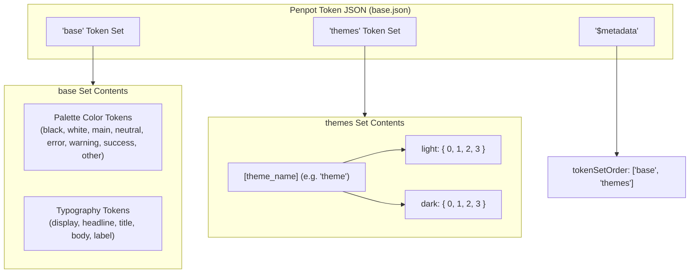
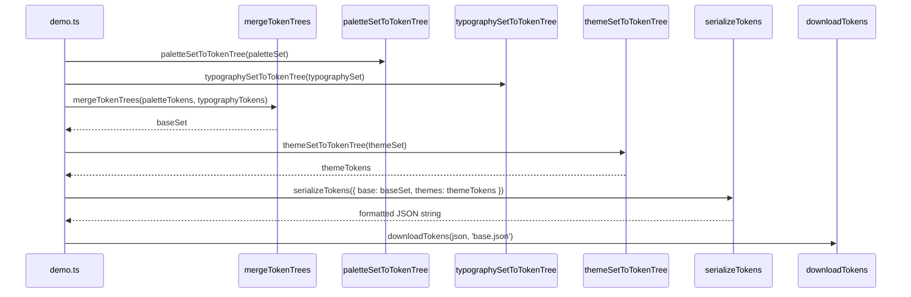

# Anima 0.6: Penpot Multi-Set Token Export & Theme Factory

## 1. Overview & Problem Statement

### 1.1 Context & Background

Anima 0.5 integrated `style-dictionary` for token serialization. However, Style Dictionary is a code compiler (compiling tokens into CSS, SCSS, or mobile assets) rather than an exporter for design tool environments.

Penpot's native design token importer enforces the **Tokens Studio multi-set JSON schema**:

- Root-level keys must be named **Token Sets** (e.g. `base`, `themes`).
- A root-level `$metadata` object containing `tokenSetOrder: string[]` is required to define set precedence and enable cross-set alias resolution.
- Leaf tokens adhere to the W3C Design Tokens Community Group (DTCG) specification (`$value`, `$type`).

Currently:

1. `serializeTokens` in `src/core/token/serialize-tokens.ts` passes tokens into Style Dictionary's in-memory instance (`sd.init()`), which outputs flat or nested token trees without sets or metadata, causing Penpot's token importer to reject the file.
2. In `src/demo/default-themes.ts`, theme definitions hardcode palette references to `'neutral'` (e.g. `'neutral.c100'`), preventing dynamic neutral palette renaming.

### 1.2 Design Goals & Invariants

- **Multi-Set Token Export**:
  - **`base` set**: Contains foundation color palette tokens (`black`, `white`, `main`, `neutral`, `error`, `warning`, `success`, `other`) and typography tokens (`display`, `headline`, `title`, `body`, `label`).
  - **`themes` set**: Contains theme token definitions grouped under the theme name (e.g. `theme` -> `light`/`dark` -> `0`..`3` -> `background`, `primary`, etc.).
  - **`$metadata` root object**: Contains `tokenSetOrder: ['base', 'themes']`.
- **Dependency Replacement**:
  - Remove `style-dictionary` from `package.json`.
  - Add `@tokens-studio/types` to provide canonical type definitions (`TokenSet`, `SingleToken`, `TokenStore`).
- **`createThemeSet` Factory**:
  - Implement `createThemeSet(name: string, mainPaletteName: string, neutralPaletteName: string): ThemeSet` in `src/core/theme/create-theme-set.ts`.
  - Refactor `INITIAL_THEME_SET` in `src/demo/default-themes.ts` to utilize `createThemeSet('theme', 'main', 'neutral')`.
- **Zero UI Disruption**:
  - Keep the demo export button ("Export Penpot tokens") and downloaded filename (`base.json`).
  - Output valid JSON that imports directly into Penpot without errors.

---

## 2. Architecture & Data Flow

### 2.1 Multi-Set Structure



### 2.2 Token Serialization Flow



---

## 3. Detailed Component Specifications

### 3.1 `createThemeSet` Factory (`src/core/theme/create-theme-set.ts`)

```typescript
export function createThemeSet(
  name: string,
  mainPaletteName: string,
  neutralPaletteName: string,
): ThemeSet;
```

- Constructs Dark 0–3 and Light 0–3 themes.
- References `${neutralPaletteName}.c...` for neutral roles and `${mainPaletteName}.c...` for display/outline/background roles.

### 3.2 Token Serialization (`src/core/token/serialize-tokens.ts`)

```typescript
import type {DeepKeyTokenMap} from '@tokens-studio/types';

export function serializeTokens(
  tokenSets: Record<string, DeepKeyTokenMap>,
  tokenSetOrder: readonly string[],
): string;
```

- Injects root `$metadata: { tokenSetOrder }`.
- Returns formatted JSON string via `JSON.stringify(store, null, 2)`.

### 3.3 Core Converters Update

- Replace `DesignTokens` / `DesignToken` imports from `style-dictionary/types` with `@tokens-studio/types` in:
  - `src/core/token/palette-set-to-token-tree.ts`
  - `src/core/token/theme-set-to-token-tree.ts`
  - `src/core/token/typography-set-to-token-tree.ts`
  - `src/core/token/merge-token-trees.ts`

### 3.4 Token Name Property (`name`)

Tokens Studio tokens include a `name: string` property on each leaf token representing its dot-separated path within its set:

- Palette color tokens: `black`, `white`, `${palette}.${shade}` (e.g. `main.50`, `neutral.100`, `error.500`)
- Theme role tokens: `${name}.${mode}.${type}.${section}` (e.g. `theme.dark.0.background`, `theme.light.1.primary`)
- Typography tokens: `${type}.${size}` (e.g. `display.large`, `body.medium`) and nested code variant `${type}.${size}.code` (e.g. `display.large.code`)

### 3.5 Demo Integration (`src/demo/`)

- `src/demo/download-tokens.ts`: Accepts single-set tokens (`tokens: DeepKeyTokenMap`) and filename (e.g. `'base.json'`), wraps into `{ [setName]: tokens }`, and calls `serializeTokens(tokenSets, [setName])`.
- `src/demo/demo.ts`: Coordinates merged token tree and triggers download via `downloadTokens(mergedTree, 'base.json')`.
- `src/demo/default-themes.ts`: Implements `INITIAL_THEME_SET = createThemeSet('theme', 'main', 'neutral')`.
