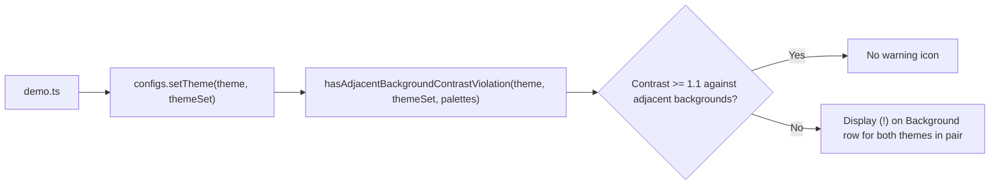
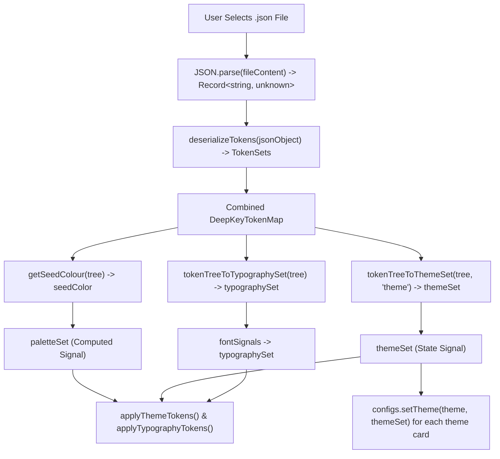
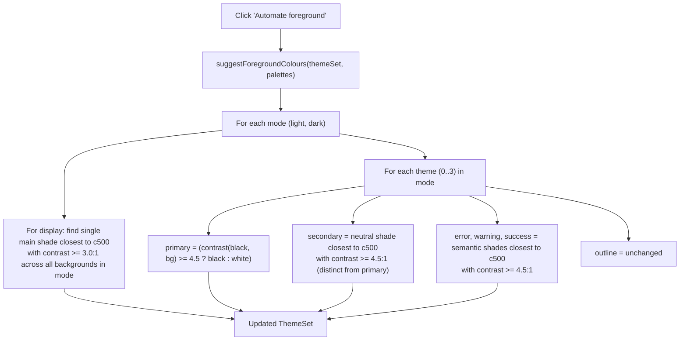

# Anima 0.7: Token Import, Background Contrast, and Intelligent Foreground Suggestions

## 1. Overview & Problem Statement

### 1.1 Context & Background

Anima 0.6 established token export in Penpot multi-set format (`base.json`), structured theme palettes, and interactive shade configuration. However, several workflow and design system constraints require enhancement:

1. **Background Hierarchy Contrast**: Surfaces have a background hierarchy (Theme 0 inset, Theme 1 canvas, Theme 2 highlight, Theme 3 super-highlight), but there is no explicit contrast validation between adjacent background colours (e.g. light.0 vs light.1, light.1 vs light.2, light.2 vs light.3, and dark counterparts).
2. **Display Shade Consistency**: Display foreground shades varied inconsistently across themes within the same mode (e.g. `c500` on light 0/1 vs `c600` on light 2/3), diluting brand cohesiveness.
3. **Token Re-import**: The demo allows exporting tokens but cannot load an existing tokens JSON file to resume editing or inspect a saved configuration. Sibling projects like `prestige_gen` also need to update existing `tokens.json` files and should reuse token deserialization from Anima.
4. **Foreground Suggestion Automation**: Finding optimal shades for primary, secondary, display, error, warning, and success that satisfy WCAG contrast requirements while staying as close as possible to the core `c500` brand shade is currently a manual trial-and-error process.

### 1.2 Design Goals & Invariants

- **Background Contrast Validation**:
  - Minimum contrast ratio between adjacent theme backgrounds: constant threshold `MIN_BACKGROUND_CONTRAST = 1.1`.
  - Evaluated between adjacent pairs in each mode:
    - 0 vs 1
    - 1 vs 2
    - 2 vs 3
  - If any pair has contrast $< 1.1$, both themes in that pair render the warning icon `(!)` on their Background row in `ThemeConfigs`.
  - `ThemeConfigs` receives its theme and theme set via method `setTheme(theme: Theme, themeSet: ThemeSet)`.
- **Display Shade Consistency Per Mode**:
  - All themes within the same mode (Light 0–3 or Dark 0–3) share the exact same `display` shade.
  - In `createThemeSet`, all Light themes default `display` to `main.c600` and all Dark themes default `display` to `main.c400` (both achieving $\ge 3.0:1$ across all backgrounds in their respective modes).
  - In `demo.ts`, selecting a new `display` shade on any theme updates all themes in that mode.
- **Token Deserialization & Loading**:
  - Centralized type definition: `export type TokenSets = Record<string, DeepKeyTokenMap>;` in `src/core/token/token-sets.ts`.
  - `deserializeTokens(data: Record<string, unknown>): TokenSets` in `src/core/token/deserialize-tokens.ts`: accepts a parsed JSON object (single-set or multi-set), strips `$metadata`, and validates/normalizes into `TokenSets`.
  - Reuse `deserializeTokens` in `prestige_gen/src/theming/write-penpot-tokens.ts`.
  - Converters in `src/core/token/`:
    - `tokenTreeToThemeSet(tokenTree: DeepKeyTokenMap, name: string): ThemeSet` in `token-tree-to-theme-set.ts`.
    - `tokenTreeToTypographySet(tokenTree: DeepKeyTokenMap): TypographySet` in `token-tree-to-typography-set.ts`.
    - `getSeedColour(tokenTree: DeepKeyTokenMap): Color | null` in `get-seed-colour.ts`.
  - In `demo.ts`:
    - Add "Import tokens" button at top of Color generator.
    - When tokens are loaded, update `themeSet`, font signals, and `seedColor`, and push updated themes to all `ThemeConfigs` instances via `setTheme(theme, themeSet)`.
- **Foreground Suggestion Automation**:
  - In `src/demo/suggest-foreground-colours.ts`, export `suggestForegroundColours(currentThemeSet: ThemeSet, palettes: PaletteSet): ThemeSet`.
  - Leaves `outline` unchanged.
  - `primary`: set to `black` (for light backgrounds) or `white` (for dark backgrounds), ensuring contrast $\ge 4.5:1$.
  - `secondary`: neutral palette shade meeting contrast $\ge 4.5:1$ closest to `c500`, distinct from primary.
  - `display`: identical `main` shade for all themes in that mode, meeting contrast $\ge 3.0:1$ across all backgrounds in that mode, closest to `c500`.
  - Status colours (`error`, `warning`, `success`): shade from the corresponding palette meeting contrast $\ge 4.5:1$ closest to `c500`.
  - Add "Automate foreground" button at top of Themes showcase.
- **Educational Paragraphs Update**:
  - Update explanatory copy in `src/demo/demo.ts` detailing all contrast rules, background hierarchy thresholds, primary/secondary distinctions, and per-mode display consistency.

---

## 2. Architecture & Data Flow

### 2.1 Background Contrast Validation Flow



### 2.2 Token Deserialization & Loading Flow



### 2.3 Foreground Suggestion Flow



---

## 3. Detailed Component Specifications

### 3.1 Background Contrast Verification (`src/core/theme/has-adjacent-background-contrast-violation.ts`)

```typescript
export const MIN_BACKGROUND_CONTRAST = 1.1;

export function hasAdjacentBackgroundContrastViolation(
  theme: Theme,
  themeSet: ThemeSet,
  palettes: PaletteSet,
): boolean;
```

- Adjacent pairs in each mode (`theme.mode`):
  - Type 0: adjacent is Type 1.
  - Type 1: adjacents are Type 0 and Type 2.
  - Type 2: adjacents are Type 1 and Type 3.
  - Type 3: adjacent is Type 2.
- For each adjacent theme: evaluates `contrast(resolveThemeColor(palettes, theme.background), resolveThemeColor(palettes, adjacent.background))`.
- If any adjacent contrast is `< MIN_BACKGROUND_CONTRAST` (1.1), returns `true`.
- Ensures both themes in a non-compliant pair display the warning icon.

### 3.2 Display Shade Consistency (`src/core/theme/create-theme-set.ts`, `src/demo/demo.ts`)

- In `createThemeSet`:
  - Light themes 0–3 default `display` to `${mainPaletteName}.c600`.
  - Dark themes 0–3 default `display` to `${mainPaletteName}.c400`.
- In `demo.ts`:
  - When `handleThemeChange` receives an updated theme where `display` changed, update all themes in that mode with the new `display` shade.

### 3.3 Token Deserialization & Conversion (`src/core/token/`)

Centralized typedef in `src/core/token/token-sets.ts`:

```typescript
import type {DeepKeyTokenMap} from '@tokens-studio/types';

export type TokenSets = Record<string, DeepKeyTokenMap>;
```

Single-export modules:

1. **`src/core/token/deserialize-tokens.ts`**:
   ```typescript
   export function deserializeTokens(data: Record<string, unknown>): TokenSets;
   ```
   Accepts a parsed JSON object (e.g. `{ base: { ... }, themes: { ... }, $metadata: { ... } }` or single set `{ base: { ... } }`), validates that set values are token maps, strips `$metadata`, and returns `TokenSets`.
2. **`src/core/token/token-tree-to-theme-set.ts`**:
   ```typescript
   export function tokenTreeToThemeSet(
     tokenTree: DeepKeyTokenMap,
     name: string,
   ): ThemeSet;
   ```
   Converts `{palette.shade}` alias values (e.g. `"{neutral.100}"` -> `"neutral.c100"`, `"{white}"` -> `"white"`) under the specified `name` back into a validated `ThemeSet`.
3. **`src/core/token/token-tree-to-typography-set.ts`**:
   ```typescript
   export function tokenTreeToTypographySet(
     tokenTree: DeepKeyTokenMap,
   ): TypographySet;
   ```
   Converts typography token nodes (`display`, `headline`, `title`, `body`, `label`) back into `TypographySet`.
4. **`src/core/token/get-seed-colour.ts`**:
   ```typescript
   export function getSeedColour(tokenTree: DeepKeyTokenMap): Color | null;
   ```
   Extracts `main.500` color value from the token tree and converts to `Color`.

### 3.4 Foreground Suggestion Algorithm (`src/demo/suggest-foreground-colours.ts`)

Located in `src/demo/` alongside demo token and UI logic:

```typescript
export function suggestForegroundColours(
  currentThemeSet: ThemeSet,
  palettes: PaletteSet,
): ThemeSet;
```

Algorithm details:

1. **Distance to 500 Ordering**:
   - For light background: `[500, 600, 400, 700, 300, 800, 200, 900, 100, 950, 50]`.
   - For dark background: `[500, 400, 600, 300, 700, 200, 800, 100, 900, 50, 950]`.
2. **Display**:
   - Tested across all 4 backgrounds in that mode simultaneously.
   - First candidate from distance order with `contrast >= 3.0:1` against all 4 backgrounds is chosen.
3. **Primary**:
   - `black` or `white` choosing whichever has contrast $\ge 4.5:1$ (preferring black on light backgrounds, white on dark backgrounds).
4. **Secondary**:
   - Tested through neutral palette shades in distance order.
   - First shade with contrast $\ge 4.5:1$ and distinct from primary.
5. **Status (`error`, `warning`, `success`)**:
   - Tested through corresponding semantic palette in distance order.
   - First shade with contrast $\ge 4.5:1$.
6. **Outline**:
   - Retained as-is from current theme.

### 3.5 Themes Update in prestige_gen

Update theme definitions and token generation in `prestige_gen`:

- Synchronize theme definitions with Anima 0.7 theme structures, contrast requirements, and synchronized display shades.
- Update `asset/tokens.json` in `prestige_gen` and verify `prestige_gen` tests pass.
